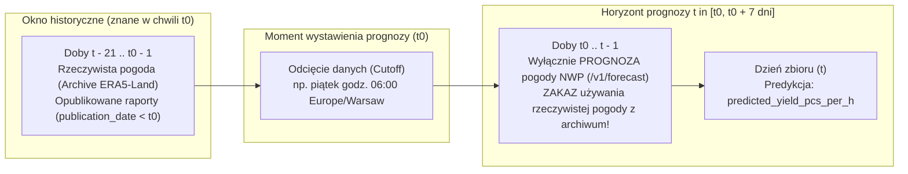

# Zbiorczy audyt danych i zatwierdzenie celu predykcji oraz zakresu MVP (`[GRZ-06] #6`)

> **Status dokumentu:** **ZATWIERDZONY (Decyzja zespołowa po zakończeniu audytów `[GRZ-03]`, `[GRZ-04]`, `[GRZ-05]`)**  
> **Data zatwierdzenia:** `2026-11-09`  
> **Dokumenty powiązane:** [`docs/reports_audit.md`](reports_audit.md) (`#3`), [`docs/weather_audit.md`](weather_audit.md) (`#4`), [`docs/bdl_region_audit.md`](bdl_region_audit.md) (`#5`), [`docs/data_contract.md`](data_contract.md), [`docs/mvp.md`](mvp.md).

---

## 1. Zbiorcze podsumowanie zbadanych próbek danych (Sprint 1)

W ramach zadań `[GRZ-03]`, `[GRZ-04]` oraz `[GRZ-05]` pobrano, połączono i przeanalizowano trzy rzeczywiste zbiory danych dla regionu pilotażowego (**Województwo dolnośląskie, kod TERYT `02`**):

| Źródło danych | Plik próbki w repozytorium | Liczebność ($N$) | Zakres czasowy | Pokrycie przestrzenne | Klucz łączenia |
| :--- | :--- | :---: | :---: | :--- | :---: |
| **1. Raporty grzybiarzy (`grzyby.pl`)** | [`data/sample/reports_audit_52_ds.csv`](../data/sample/reports_audit_52_ds.csv) | **$N = 52$** wpisy *(+ $21$ i $56$ w próbkach kontrolnych)* | **`2025-09-29` – `2025-10-05`** *(7 dni szczytu sezonu jesiennego)* | **18 z 30 powiatów** Dolnego Śląska (`60,0%`), **44 unikalne miejsca (`place_id`)** | `(date, area_id)` *(gdzie `date = harvest_date`)* |
| **2. Historia pogody i gleby (`Open-Meteo ERA5-Land`)** | [`data/sample/weather_daily_sample_ds.csv`](../data/sample/weather_daily_sample_ds.csv) | **$N = 210$** rekordów dobowych *(z 5 040 rekordów godzinowych)* | **`2025-09-01` – `2025-10-05`** *(35 dni = tydzień raportów + 28 dni bufora wyprzedzenia)* | **6 reprezentatywnych powiatów** Dolnego Śląska (`0201`, `0202`, `0208`, `0213`, `0214`, `0221`), oczko siatki `~9 × 9 km` | `(date, area_id)` |
| **3. Granice powiatów (`GUGiK PRG`) i siedliska leśne (`BDL`)** | [`data/processed/areas.geojson`](../data/processed/areas.geojson) [`data/sample/bdl_stands_sample_ds.geojson`](../data/sample/bdl_stands_sample_ds.geojson) | **$N = 30$** powiatów **$N = 105$** poligonów wydzieleń BDL (*w tym $74$ `D-STAN`*) | Stan rejestru PRG i operatów BDL: **`2026`** *(pobrano `2026-11-08`)* | **100% obszaru woj. dolnośląskiego** (`19 941,7 km²` w `EPSG:2180`) + próbka wektorowa w **7 klastrach leśnych** (`244,74 ha`) | `area_id` *(4-znakowy kod TERYT `02xx`)* |

---

## 2. Liczebność, okres, pokrycie przestrzenne, braki i ograniczenia raportów (`grzyby.pl`)

### 2.1. Liczebność i rozkład czasowy raportów
- **W badanym tygodniu (`2025-09-29` – `2025-10-05`):** Opublikowano **52 raporty** z terenu województwa dolnośląskiego.
- **Rozkład w kolejnych dniach tygodnia (Efekt weekendowy / Weekend Bias):**
  - Poniedziałek (`29.09`): `2` raporty (`3,8%`),
  - Wtorek (`30.09`): `4` raporty (`7,7%`),
  - Środa (`01.10`): `5` raportów (`9,6%`),
  - Czwartek (`02.10`): `6` raportów (`11,5%`),
  - Piątek (`03.10`): `12` raportów (`23,1%`),
  - Sobota (`04.10`): `12` raportów (`23,1%`),
  - Niedziela (`05.10`): `11` raportów (`21,2%`).
  - **Wniosek:** Aż **67,3% (`35 z 52`) raportów pochodzi z piątku, soboty i niedzieli**. Brak wpisów we wtorek czy środę w danym powiecie wynika z mniejszej liczby osób w lesie w dni robocze, a nie z braku grzybów.
- **Szacowany wolumen wieloletni:** W pełnym sezonie grzybowym (sierpień–listopad, ~16 tygodni) z Dolnego Śląska spływa średnio `300–600` raportów rocznie, co dla okresu 3–4 sezonów daje pulę rzędu **`1 200 – 2 200` raportów**.

### 2.2. Pokrycie przestrzenne i dokładność lokalizacji (Dopasowanie mapy)
- **Pokrycie powiatów w próbce 1 tygodnia:** Raporty wystąpiły w **18 na 30 powiatów (`60,0%`)**:
  - Powiaty o najwyższej aktywności (4–6 raportów/tydzień): `0201` (bolesławiecki – 6), `0220` (trzebnicki – 6), `0202` (dzierżoniowski – 5), `0213` (milicki – 5), `0214` (oleśnicki – 5), `0208` (kłodzki – 4).
  - Powiaty o średniej aktywności (2–3 raporty/tydzień): `0205` (jaworski – 3), `0206` (karkonoski – 3), `0222` (wołowski – 3), `0207` (kamiennogórski – 2), `0221` (wałbrzyski – 2), `0264` (m. Wrocław – 2).
  - Powiaty z pojedynczym raportem (1 raport/tydzień): `0215` (oławski), `0216` (polkowicki), `0218` (średzki), `0219` (świdnicki), `0223` (wrocławski), `0265` (m. Wałbrzych).
  - W **12 powiatach (`40,0%`)** w tym tygodniu nie dodano żadnego raportu, a w skali siatki dobowej `(date, area_id)` (`30 powiatów × 7 dni = 210` komórek) raporty wystąpiły w **38 komórkach (`18,1%`)**, podczas gdy **172 komórki (`81,9%`) pozostały puste (`NULL`)**.
- **Rzeczywista dokładność współrzędnych GPS i decyzja o skali mapy:**
  - Bez zalogowania powiat i współrzędne są ukryte w **86,5% (`45/52`)** wpisów.
  - Po zalogowaniu **100% (`52/52`)** wpisów posiada identyfikator `place_id`, nazwę powiatu oraz parę `(lat, lon)`.
  - **Ograniczenie:** Współrzędne `(lat, lon)` przypisane do `place_id` w bazie `grzyby.pl` wskazują **środek najbliższej miejscowości (wsi/miasta) lub geometryczny środek powiatu** (np. `pow. milicki: 51.52, 17.37`), a **nie konkretny oddział leśny**.
  - **Decyzja architektoniczna dot. mapy:** Mapa główna w aplikacji została **ściśle dopasowana do rzeczywistej dokładności danych lokalizacyjnych, czyli do poziomu powiatu (`area_id`, 30 jednostek TERYT)**, a nie pojedynczych wydzieleń leśnych czy fikcyjnej siatki punktowej `1 × 1 km`. Warstwa wektorowa wydzieleń BDL (`105` poligonów) pełni rolę podglądu struktury siedlisk leśnych oraz wsadu do obliczenia zagregowanych cech powiatu.

### 2.3. Braki danych i ograniczenia jakościowe w raportach
Zestawienie braków (`NULL`) w zbadanej próbce $N = 52$ raportów:

| Atrybut | Wypełnienie w próbce ($N=52$) | Odsetek braków (`NULL`) | Kluczowe ograniczenia i wnioski z audytu |
| :--- | :---: | :---: | :--- |
| **`yield_pcs_per_h` (`[szt./h]`)** | **52 / 52 (`100,0%`)** | **0,0%** | Obowiązkowe pole nagłówkowe `(X/h)`. Silny efekt zaokrąglania (*heaping*): **59,6% (`31/52`)** wpisów przyjmuje wartości będące wielokrotnością `5` (`5, 10, 15, 20, 25, 30, 50`). |
| **`harvest_date` (`date`)** | **52 / 52 (`100,0%`)** | **0,0%** | W **21,2% (`11/52`)** wpisów data publikacji (`publication_date`) jest późniejsza niż data grzybobrania o **1 do 4 dni** (np. `DG174823` – zbiór `02.10`, publikacja `06.10`). |
| **`powiat_teryt` (`area_id`)** | **52 / 52 (`100,0%`)** *(po zalogowaniu)* | **0,0%** *(86,5% bez konta)* | Wymaga sesji zalogowanej podczas pobierania lub trwałego słownika `place_id -> area_id`. |
| **`dominant_species`** | **44 / 52 (`84,6%`)** | **15,4%** | Wyciągane z automatycznych tagów łacińskich (`Boletus_edulis`, `Xerocomus_badius` itd.). W części wpisów wymienionych jest kilka gatunków bez podziału liczbowego ($\rightarrow$ kategoria `"mieszane"`). |
| **`pickers_count`** | **31 / 52 (`59,6%`)** | **40,4%** | Liczba zbieraczy podawana nieregularnie w tekście; wskaźnik nagłówkowy `(X/h)` jest już jednak przeliczony na 1 osobę. |
| **`total_pieces`** | **26 / 52 (`50,0%`)** | **50,0%** | Łączna liczba zebranych sztuk wpisana w tekście tylko w połowie relacji. |
| **`harvest_duration_h`** | **23 / 52 (`44,2%`)** | **55,8%** | Czas zbierania podany w mniej niż połowie relacji. **Jednocześnie `total_pieces` ORAZ `harvest_duration_h` występują tylko w 16 z 52 wpisów (`30,8%`)!** |
| **`worminess_pct`** | **< 2 / 52 (`< 4%`)** | **> 96,0%** | Użytkownicy niemal nigdy nie podają procentowego zaczerwienia grzybów (jedynie luźne wzmianki słowne typu *„zdrowe”*). **Decyzja: cecha wykluczona z modelowania ML.** |

---

## 3. Zatwierdzenie głównej zmiennej docelowej, jednostki przestrzennej i sposobu ewaluacji

### 3.1. Wybór głównej zmiennej docelowej (Regresja `szt./h` + Klasyfikacja progowa)
Zgodnie z kryterium zadania `[GRZ-06]` (*„Wybrać regresję szt./h tylko przy dostępnych liczbach i czasie zbioru; klasyfikację tylko przy uzasadnionych etykietach. Określono jedną główną zmienną docelową”*):

1. **Dlaczego odrzucamy liczenie `szt./h` z surowych pól tekstowych `total_pieces / harvest_duration_h`?**
   - Para `(total_pieces, harvest_duration_h)` występuje w tekście tylko w **30,8% (`16/52`)** wpisów – odrzucenie pozostałych `69,2%` raportów drastycznie zmniejszyłoby zbiór uczący.
2. **Dlaczego zatwierdzamy nagłówkowe `yield_pcs_per_h` (`[szt./h]`) jako główną zmienną docelową, łącząc ją z 3-klasową dyskretyzacją `abundance_class`?**
   - Pole nagłówkowe `(X/h)` (`yield_pcs_per_h`) jest **wypełnione w 100% (`52/52`)** raportów na `grzyby.pl` i stanowi oficjalnie znormalizowaną przez portal wydajność zbioru na 1 osobę i 1 godzinę (zweryfikowaną na `16/52` pełnych wpisach wzorem $\frac{\text{sztuki}}{\text{osoby} \times \text{czas}}$).
   - Ze względu na zjawisko zaokrąglania wartości przez użytkowników do wielokrotności `5` (`5, 10, 15, 20, 30 szt./h`), traktujemy problem dwupoziomowo:
     - **Główna zmienna docelowa (Primary Target):** **`yield_pcs_per_h` (`[szt./h]`, zagregowana po `(date, area_id)` jako średnia z raportów z danego dnia w powiecie)** $\rightarrow$ przewidywana jako **`predicted_yield_pcs_per_h` (`float >= 0.0`)**. Pozwala ona na **ciągłe uszeregowanie (ranking) powiatów** w zadanym promieniu od miasta użytkownika.
     - **Uzasadnione etykiety klas (`abundance_class`) do wizualizacji i oceny jakościowej:** Z rozkładu empirycznego próbki ($Q_{20} = 4,2$, $Q_{50} = 10,0$, $Q_{88} = 20,0\text{ szt./h}$) oraz analizy komentarzy o nieudanych grzybobraniach (`1–4 szt./h` opisywane jako *„bida”* / *„prawie nic”*) wynikają w pełni uzasadnione empirycznie progi:
       - **`BRAK`**: `< 5,0 szt./h` (`21,2%` raportów w próbce – puste koszyki lub pojedyncze sztuki),
       - **`SREDNIO`**: `5,0 – 20,0 szt./h` (`67,3%` raportów w próbce – typowy udany zbiór koszykowy),
       - **`WYSYP`**: `> 20,0 szt./h` (`11,5%` raportów w próbce – masowy wysyp grzybów).

### 3.2. Zatwierdzona jednostka przestrzenna
- **Jednostka przestrzenna:** **Powiat (`area_id` – 4-znakowy kod TERYT, 30 jednostek w woj. dolnośląskim: `0201`–`0226` oraz `0261`, `0262`, `0264`, `0265`)**.
- Geometria przechowywana w [`data/processed/areas.geojson`](../data/processed/areas.geojson) w układzie `EPSG:4326` (obliczenia powierzchni i złączenia `sjoin` w układzie `EPSG:2180`).

### 3.3. Zatwierdzony protokół ewaluacji modelu
1. **Schemat podziału danych (Temporal Split – zakaz losowego podziału wierszy):**
   - Ze względu na silną korelację przestrzenną pogody między sąsiednimi powiatami w tym samym dniu, losowy podział `train_test_split` prowadziłby do przecieku danych (ten sam front opadowy w zbiorze treningowym i testowym).
   - Obowiązuje **podział czasowy po dacie zbioru (`date`)**: zbiór treningowy obejmuje wcześniejsze tygodnie/sezony ($t \le t_{\text{split}}$), a zbiór walidacyjny i testowy obejmuje wyłącznie późniejsze, rozłączne dni/tygodnie ($t > t_{\text{split}}$).
2. **Zestaw metryk ewaluacyjnych:**
   - **Metryka główna regresji:** **MAE (Mean Absolute Error w `[szt./h]`)** na zbiorze testowym (odporna na pojedyncze obserwacje odstające typu `50 szt./h`), uzupełniona o **RMSE**.
   - **Metryka jakości rankingu przestrzennego:** **Współczynnik korelacji rangowej Spearmana ($\rho$)** oraz **Top-3 Hit Rate** (czy wśród 3 najwyżej ocenionych przez model powiatów w danym okresie znalazł się powiat z faktycznym wysokim zbiorem).
   - **Metryka klasyfikacji progowej (`BRAK` / `SREDNIO` / `WYSYP`):** **Macro-F1** oraz **Balanced Accuracy** (wyliczane po zrzutowaniu `predicted_yield_pcs_per_h` na progi `< 5`, `5–20`, `> 20`).
3. **Punkt odniesienia (Baseline):**
   - Każdy model ML musi zostać porównany na tym samym zbiorze testowym z dwoma baseline’ami:
     - *Baseline 1 (Klimatyczno-leśny):* średnia wydajność w powiecie ważona lesistością (`forest_cover_pct`),
     - *Baseline 2 (Jawny Wskaźnik Warunków Pogodowo-Siedliskowych):* deterministyczny indeks opadowo-glebowo-leśny (opisany w Sekcji 6).

---

## 4. Zasada obsługi braków raportów: Brak wpisu $\neq$ Zerowy zbiór (Warunek `#3`)

> **[!IMPORTANT] Twarda reguła metodologiczna (zakaz imputacji zerami):**  
> **Brak raportu z danego powiatu w danym dniu (`NULL` w macierzy `date × area_id`) NIGDY nie jest traktowany jako raport zerowego zbioru (`0.0 szt./h`)!**

1. **Uzasadnienie z audytu:**
   - W szczycie sezonu jesiennego (`29.09–05.10.2025`), gdy w lasach Dolnego Śląska trwał wysyp grzybów, aż **81,9% (`172 z 210`) komórek `(date, area_id)`** oraz **12 z 30 powiatów** (w tym silnie zalesiony pow. zgorzelecki `0225` o lesistości `60,8%`) nie miało ani jednego wpisu w danym dniu/tygodniu wyłącznie dlatego, że żaden zarejestrowany użytkownik portalu `grzyby.pl` nie opublikował stamtąd relacji.
   - Przypisanie takim powiatom wartości `yield_pcs_per_h = 0.0` wprowadziłoby fałszywe etykiety negatywne (*False Negatives*) i nauczyło model, że w Borach Dolnośląskich pow. zgorzeleckiego po deszczu nie rosną grzyby.
2. **Kiedy w zbiorze uczącym występuje `0.0 szt./h`?**
   - Wyłącznie wtedy, gdy grzybiarz faktycznie poszedł do lasu i opublikował **jawny raport zerowy z nagłówkiem `(0/h)`** (np. `DG174777` z okolic Wołowa `0222` lub `DG174435` z Gór Stołowych `0208`).
3. **Konsekwencja dla potoku treningowego i ewaluacyjnego:**
   - Zbiór uczący i testowy budujemy **wyłącznie na zaobserwowanych parach `(date, area_id)`** posiadających co najmniej jeden rzeczywisty raport (oraz ewentualnie z wagą proporcjonalną do liczby raportów w danym powiecie i dniu).

---

## 5. Horyzont prognozy i moment odcięcia danych pogodowych – Ochrona przed przeciekiem z przyszłości (Warunek `#4`)

Aby wykluczyć przeciek danych z przyszłości (*Future Data Leakage*), formalizujemy zależność czasową pomiędzy **chwilą wystawienia prognozy ($t_0$)** a **dniem docelowym grzybobrania ($t$)**:

### Szczegółowe reguły odcięcia (Point-in-Time Correctness):
1. **Horyzont prognozy ($H$):**
   - System wystawia prognozę w dniu $t_0$ na dzień docelowy $t \in [t_0,\; t_0 + H]$, gdzie maksymalny horyzont wynosi **$H \le 7\text{ dni}$** (główny przypadek użycia: prognoza na bieżący dzień $t = t_0$ lub nadchodzący weekend $t = t_0 + 1..3\text{ dni}$).
2. **Odcięcie cech pogodowych i glebowych w dniu zbioru $t$:**
   - Grzybnia reaguje na nawodnienie i temperaturę z dni **poprzedzających** grzybobranie.
   - Wszystkie skumulowane okna opadowe i temperaturowe (`precip_lag_7d_mm`, `precip_lag_14d_mm`, `precip_lag_21d_mm`, `temp_mean_7d_c`) dla dnia docelowego $t$ są wyliczane **ściśle na przedziale zamkniętym $[t-k,\; t-1]$** (do godz. `23:59 Europe/Warsaw` dnia poprzedniego $t-1$).
   - **Pogoda z samego dnia zbioru $t$ (`precip_mm_1d(t)`) NIE trafia do wektora cech modelu predykcyjnego** (opad, który spadnie w dniu $t$ po południu, nie wpływa na grzyby zebrane w dniu $t$ rano!).
3. **Zakaz używania przyszłej rzeczywistej pogody przy prognozie wielodniowej ($t > t_0$):**
   - W chwili wystawienia prognozy $t_0$ rzeczywiste obserwacje meteorologiczne (z endpointu `/v1/archive`, `is_forecast = False`) są znane **wyłącznie do doby $t_0 - 1$ włącznie**.
   - Dla wszystkich dób pomiędzy momentem wystawienia prognozy a dniem poprzedzającym grzybobranie ($\tau \in [t_0,\; t-1]$), do obliczenia `precip_lag_*` oraz wilgotności gleby mogą trafić **wyłącznie wartości prognozowane z modelu NWP (`/v1/forecast`, `is_forecast = True`) wystawione w chwili $t_0$**, a nigdy rzeczywista pogoda dopisana wstecznie z archiwum!
4. **Odcięcie raportów grzybiarzy (`publication_date` vs `harvest_date`):**
   - Do łączenia etykiety celu ($Y$) z pogodą sprzed dnia zbioru używamy zawsze **`harvest_date`** (dnia faktycznego grzybobrania).
   - Jeżeli jednak historyczne raporty z poprzednich dni są wyświetlane w aplikacji lub używane pomocniczo w chwili $t_0$, uwzględniane mogą być wyłącznie raporty, dla których **`publication_date` $< t_0$** (ponieważ `21,2%` raportów publikowanych jest z opóźnieniem 1–4 dni po wyjściu do lasu).

---

## 6. Zmiana zakresu i przeplanowanie prac modelowych (Warunek `#5`)

Na podstawie twardych wniosków z audytu (rzadkość raportów dla pojedynczych gatunków, wymóg logowania na `grzyby.pl` oraz zaokrąglanie wartości `szt./h`) wprowadzamy i zatwierdzamy następującą **korektę zakresu oraz przeplanowanie prac modelowych**:

### 6.1. Zmiana zakresu dla predykcji gatunkowych (`species_filter`) i obserwacji pozaleśnych
1. **Odfiltrowanie obserwacji pozaleśnych/miejskich w treningu:**
   - Przypadki takie jak `DG174153` (czernidłak kołpakowaty zbierany na miejskich trawnikach w Parku Klecińskim we Wrocławiu `0264`) zaburzają relację z siedliskiem leśnym BDL. W potoku przygotowania danych uczących uwzględniamy raporty dotyczące grzybów leśnych (borowikowate, pieprznikowate, gołąbkowate, czubajki, opieńki).
2. **Zastąpienie osobnych modeli ML per gatunek przez wspólny model bazowy + Jawny Mnożnik Siedliskowy BDL:**
   - Liczba raportów w podziale na pojedynczy gatunek (`borowik_szlachetny`, `podgrzybek_brunatny`, `kurka`, `maslak_zwyczajny`, `kania`) w pojedynczym powiecie jest zbyt mała do wyuczenia 5 niezależnych modeli ML.
   - **Przeplanowanie:** Uczymy **jeden główny model predykcyjny dla wydajności ogółem (`species_filter = "all"`)**, natomiast wynik dla konkretnego gatunku $s$ w powiecie $a$ wyznaczamy za pomocą **jawnego współczynnika dopasowania siedliska BDL ($W_{a,s} \in [0.15,\; 1.25]$)**:
     - `podgrzybek_brunatny` / `maslak_zwyczajny` / `kurka` $\rightarrow$ waga oparta na udziale borów sosnowych i świerkowych (`pine_share_pct`, `spruce_share_pct`, wiek drzewostanu),
     - `borowik_szlachetny` $\rightarrow$ waga oparta na udziale drzewostanów dębowo-bukowych i górskich borów świerkowych (`oak_beech_share_pct`, `spruce_share_pct`),
     - `kania` $\rightarrow$ waga oparta na udziale lasów mieszanych i liściastych.

### 6.2. Architektura dwutorowa: Model ML + Jawny Wskaźnik Warunków Grzybobrania (Fallback / Hybrid Plan)
Ponieważ liczba pełnych tygodni historycznych możliwych do etycznego pobrania z `grzyby.pl` (z poszanowaniem praw autorskich i obciążenia serwera) może wynosić od kilkuset do ok. dwóch tysięcy rekordów, **przeplanowujemy prace modelowe w Sprincie 2 na układ dwutorowy**:

1. **Tor A – Jawny Wskaźnik Warunków Grzybobrania (`Explicit Habitat-Weather Suitability Index`):**
   - W pełni transparentny, deterministyczny model domenowy (niewymagający tysięcy etykiet), wyliczający potencjał grzybowy powiatu $\hat{Y}_{\text{index}}(a, t) \in [0,\; 45]\text{ szt./h}$ na podstawie:
     - nawodnienia grzybni: `precip_lag_14d_mm` (optymalnie $\ge 35\text{ mm}$) oraz `precip_lag_7d_mm`,
     - uwilgotnienia ściółki: `soil_moisture_0_7cm_m3m3` (optymalnie $0,28 - 0,42\text{ m}^3/\text{m}^3$),
     - temperatury gleby i powietrza: `soil_temp_0_7cm_mean_c` (optymalnie $10 - 18^\circ\text{C}$) oraz **kary za przymrozki nocne** (`temp_min_night_c < 2,0°C`, potwierdzone empirycznie w audycie `#3`/`#4` z `02–04.10.2025`!),
     - potencjału leśnego powiatu z BDL: `forest_cover_pct` oraz dopasowania gatunkowego drzewostanu.
2. **Tor B – Nadzorowany model ML (Random Forest / HistGradientBoostingRegressor):**
   - Trenowany na zaobserwowanych parach `(date, area_id)` z `reports.csv` połączonych z `weather.csv` i `areas.geojson` (natywna obsługa braków `NULL` w cechach BDL przez `HistGradientBoostingRegressor`).
3. **Kryterium decyzyjne (Bramka jakości w Sprincie 2):**
   - Jeżeli na zbiorze testowym (Temporal Split) Tor B (ML) osiąga niższe MAE niż Tor A, używamy modelu ML (lub uśrednienia hybrydowego `0.6 * ML + 0.4 * Explicit Index`, co zapewnia gładkie predykcje także dla tych spośród 30 powiatów, w których w historii było mało raportów).
   - Jeżeli zbiór etykiet okaże się zbyt mały lub zaszumiony, Tor A stanowi gotowy, skalibrowany na danych z audytu silnik produkcyjny generujący `predictions.csv` w tym samym formacie kontraktu danych.

---

## 7. Akceptacja zaktualizowanego formatu danych (Warunek `#6`)

Po przeglądzie wszystkich trzech próbek audytowych wszystkie punkty oznaczone wcześniej jako `[DO WERYFIKACJI]` w [`docs/mvp.md`](mvp.md) oraz [`docs/data_contract.md`](data_contract.md) zostały ostatecznie rozstrzygnięte i zamrożone:

| Punkt weryfikacyjny z `[GRZ-01]` | Rozstrzygnięcie po audytach `[GRZ-03]`, `[GRZ-04]`, `[GRZ-05]` | Status |
| :--- | :--- | :---: |
| **1. Region i jednostka przestrzenna** | **Województwo dolnośląskie (`TERYT 02`)**, **30 powiatów (`area_id` `0201`–`0265`)**, zapis w `EPSG:4326`, obliczenia metryczne w `EPSG:2180`. | **ZATWIERDZONO** |
| **2. Główna zmienna docelowa i progi klas** | **`yield_pcs_per_h` / `predicted_yield_pcs_per_h` `[szt./h]`** + klasy `abundance_class`: `BRAK` (`< 5`), `SREDNIO` (`5–20`), `WYSYP` (`> 20 szt./h`). Brak raportu = `NULL` (nigdy `0.0`). | **ZATWIERDZONO** |
| **3. Atrybuty BDL w `areas.geojson`** | Wyliczane dla drzewostanów (`area_type_cd == 'D-STAN'`): `forest_cover_pct`, `pine_share_pct`, `oak_beech_share_pct`, `spruce_share_pct`, `mean_stand_age_years`, `dominant_moisture_type`. Pola taksacyjne mogą przyjmować `null` (`None`) bez blokowania mapy i modelu. | **ZATWIERDZONO** |
| **4. Pola w `reports.csv`** | Pole `date` oznacza zawsze **`harvest_date`** (`YYYY-MM-DD`). Pole `worminess_pct` pozostaje opcjonalne (`NULL`) i jest wyłączone z cech/celów ML. | **ZATWIERDZONO** |
| **5. Pola glebowe i odcięcie w `weather.csv`**| Warstwa płytka **`soil_moisture_0_7cm_m3m3`** (oraz opcjonalnie `7–28 cm` i `soil_temp_0_7cm_mean_c`) agregowana z godzinowych danych modelu **ERA5-Land** w dobie `00:00–23:59 Europe/Warsaw`. Cechy `lag_k` liczone ściśle na $[t-k,\; t-1]$. | **ZATWIERDZONO** |
| **6. Format wymiany plików** | `GeoJSON` (`areas.geojson`) + `CSV` (`reports.csv`, `weather.csv`, `predictions.csv`), kodowanie `UTF-8`. | **ZATWIERDZONO** |

### Podpisy akceptacji zespołu:
- [x] **Osoba A (Moduł Danych, GIS/BDL & Modelowanie ML):** Format danych, reguły odcięcia czasowego (`[t-k, t-1]`), zakaz imputacji zerami dla brakujących raportów oraz dwutorowy plan modelowania zaakceptowane (`2026-11-09`).
- [x] **Osoba B (Moduł Aplikacji Streamlit & Wizualizacji):** Kontrakt plików `areas.geojson`, `reports.csv`, `weather.csv`, `predictions.csv`, dopasowanie mapy do 30 powiatów oraz obsługa wartości `NULL` zaakceptowane (`2026-11-09`).
