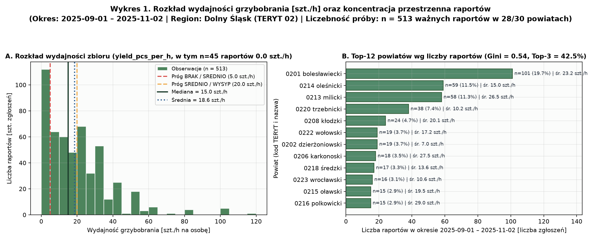
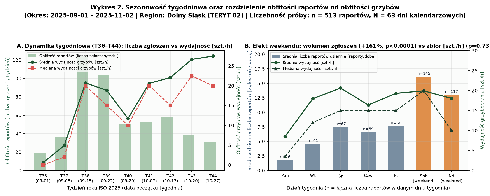
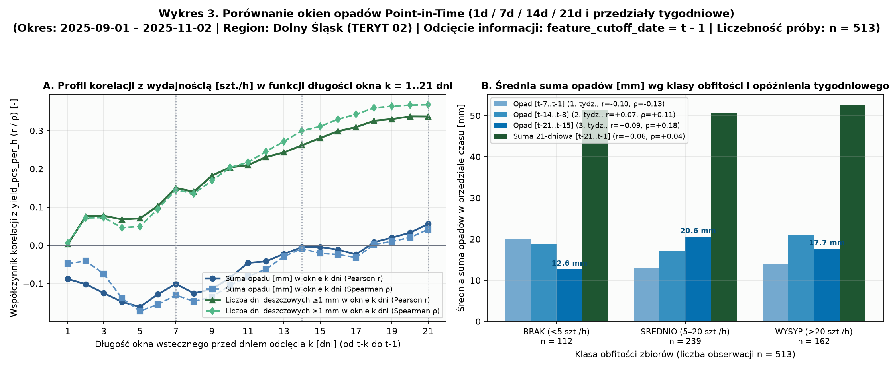
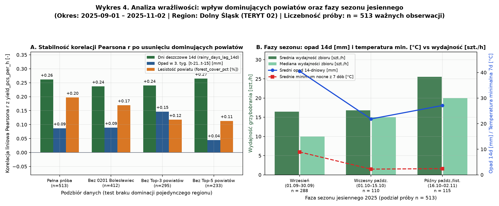
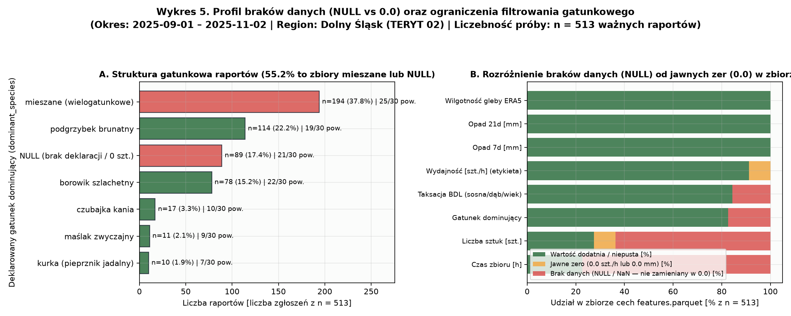

# [GRZ-11] Eksploracyjna analiza danych (EDA) i badanie opóźnienia opad → raportowane zbiory

> **Status dokumentu:** Zatwierdzony raport analityczny (`[GRZ-11]`, Sprint 2)  
> **Zbiór wejściowy:** [`data/processed/features.parquet`](../data/processed/features.parquet) (`n = 513` ważnych obserwacji treningowych z `518` wyodrębnionych w `[GRZ-07]`, `70` kolumn z `[GRZ-10]`)  
> **Region i okres:** Województwo dolnośląskie (`TERYT 02`, `28 / 30` powiatów z obserwacjami), `2025-09-01 – 2025-11-02` (`63` dni kalendarzowych; archiwum pogodowe od `2025-08-01`)  
> **Powiązane artefakty:** [`notebooks/01_eda_lag_effect.ipynb`](../notebooks/01_eda_lag_effect.ipynb), [`data/processed/eda_summary.json`](../data/processed/eda_summary.json), [`scripts/run_eda_and_lag_analysis.py`](../scripts/run_eda_and_lag_analysis.py)

---

## 1. Podsumowanie zarządcze (Executive Summary)

1. **Rozkład wydajności zbioru (`yield_pcs_per_h [szt./h]`):** W próbie `n = 513` raportów średnia wydajność wynosi **`18.59 szt./h`** ($\text{SD} = 18.00\text{ szt./h}$), a mediana **`15.0 szt./h`** ($\text{IQR} = [5.0, 30.0]\text{ szt./h}$, zakres `0.0–120.0 szt./h`). Rozkład jest prawostronnie skośny ($\text{skośność} = 1.869$) i zawiera **`45` jawnych raportów zerowego zbioru** (`8.77%`), które stanowią potwierdzone puste wyjścia do lasu (*twarde negatywy*).
2. **Obfitość raportów $\neq$ obfitość grzybów:** Liczba publikowanych zgłoszeń dziennie (**obfitość raportów**) rośnie w weekendy aż **`2.61`-krotnie** (`14.56` raportu/dobę w Sob–Nd vs `5.58` raportu/dobę w Pn–Pt, test Manna-Whitneya $p = 8 \cdot 10^{-6}$). Jednocześnie **obfitość grzybów** mierzona wydajnością na godzinę (`yield_pcs_per_h`) **nie różni się między weekendem a dniami roboczymi** (mediana `15.0` vs `15.0 szt./h`, średnia `19.08` vs `18.07 szt./h`, $p = 0.726$). Wolumen raportów odzwierciedla czas wolny zbieraczy, a nie zagęszczenie owocników w lesie.
3. **Porównanie okien opadów i efekt opóźnienia (*Lag Effect*):**
   - Surowa suma opadów w krótkim oknie wykazuje **słabą ujemną korelację** z bieżącym zbiorem (`precip_cutoff_1d_mm`: $r = -0.088, p = 0.046$; `precip_lag_7d_mm`: $r = -0.101, \rho = -0.131, p = 0.003$).
   - Wraz z wydłużaniem okna wstecznego korelacja przechodzi przez zero (`precip_lag_14d_mm`: $r = -0.005, p = 0.916$) do wartości dodatnich (`precip_lag_21d_mm`: $r = +0.056, p = 0.209$).
   - Po rozbiciu okna 21-dniowego na rozłączne tygodnie istotny dodatni sygnał pojawia się w **2. tygodniu przed zbiorem** (`[t-14..t-8]`: $\rho = +0.111, p = 0.012$) oraz **3. tygodniu przed zbiorem** (`[t-21..t-15]`: $r = +0.087, p = 0.049$; $\rho = +0.180, p = 4.2 \cdot 10^{-5}$; test Kruskala-Wallisa między klasami `BRAK / SREDNIO / WYSYP`: $H = 33.25, p < 0.0001$).
   - **Kluczowe odkrycie dla modelu:** Częstość dni deszczowych ($\ge 1.0\text{ mm/dobę}$) wykazuje wielokrotnie silniejszy związek ze zbiorami niż surowa suma milimetrów: `rainy_days_lag_7d_count` osiąga $r = +0.150$ ($p = 0.0007$), `rainy_days_lag_14d_count` osiąga **$r = +0.262, \rho = +0.300$ ($p < 10^{-8}$)**, a w oknie 21-dniowym liczba dni deszczowych osiąga **$r = +0.337, \rho = +0.368$ ($p < 10^{-12}$)**. Regularne nawilżanie ściółki przez wiele dni sprzyja owocnikowaniu bardziej niż pojedyncza gwałtowna ulewa.
4. **Brak dominacji pojedynczego regionu lub sezonu:** Choć powiat bolesławiecki (`0201`, Bory Dolnośląskie) generuje `19.69%` raportów (`n = 101`), a Top-3 powiaty (`0201, 0214, 0213`) `42.50%`, wykluczenie Top-1, Top-3, a nawet Top-5 powiatów **nie zmienia znaku ani istotności głównych zależności** (dla `rainy_days_lag_14d_count` korelacja bez Top-5 powiatów wynosi nadal $r = +0.265, \rho = +0.314, p = 4.2 \cdot 10^{-5}$).
5. **Ograniczenia filtrowania gatunków:** Aż **`55.17%` (`283 / 513`)** obserwacji nie wskazuje pojedynczego gatunku (`194` raporty to kosze `mieszane`, a `89` ma `NULL`). Gatunki takie jak kania (`n = 17`), maślak (`n = 11`) i kurka (`n = 10`) mają zbyt mało obserwacji na budowę osobnych modeli ML per gatunek.

---

## 2. Rozkład wydajności zbiorów (`yield_pcs_per_h`) i koncentracja przestrzenna



### 2.1. Statystyki opisowe zmiennej docelowej (`n = 513`)
| Parametr | Wartość | Jednostka / Uwagi |
| :--- | :---: | :--- |
| **Liczba zwalidowanych obserwacji ($n$)** | `513` | Z `518` wyodrębnionych ogółem (`5` odrzuconych w `[GRZ-07]`) |
| **Średnia ($\mu$) / Odchylenie std. ($\sigma$)** | `18.59` / `18.00` | `szt./h` na 1 osobę |
| **Kwartyle ($Q_1$ / Mediana / $Q_3$ / $P_{90}$)** | `5.0` / `15.0` / `30.0` / `40.0` | `szt./h` (rozstęp międzykwartylowy $\text{IQR} = 25.0\text{ szt./h}$) |
| **Zakres ($\min$ – $\max$) i skośność** | `0.0` – `120.0` (`1.869`) | Rozkład silnie prawostronnie skośny |
| **Jawne raporty zerowe (`yield_pcs_per_h == 0.0`)** | `45` (`8.77%`) | Potwierdzone puste wyjścia do lasu (*twarde negatywy*) |
| **Klasy obfitości (`BRAK` / `SREDNIO` / `WYSYP`)** | `112` / `239` / `162` | `21.83%` (`<5`) / `46.59%` (`5–20`) / `31.58%` (`>20 szt./h`) |

### 2.2. Pokrycie i koncentracja przestrzenna w powiatach (`TERYT 02`)
- Obserwacje obejmują **`28 z 30` powiatów** województwa dolnośląskiego (`0` raportów w `0217 powiat strzeliński` oraz `0262 m. Legnica`).
- Współczynnik koncentracji Giniego wynosi **`0.5443`** (dla wszystkich 30 powiatów) oraz **`0.5118`** (dla 28 aktywnych powiatów).
- Największe skupienie zgłoszeń występuje w dużych kompleksach borów sosnowych i lasów górskich:
  1. **`0201` powiat bolesławiecki (Bory Dolnośląskie):** `101` raportów (`19.69%`), średnia `23.24 szt./h`, mediana `20.0 szt./h`, lesistość `61.4%`.
  2. **`0214` powiat oleśnicki:** `59` raportów (`11.50%`), średnia `14.97 szt./h`, mediana `12.0 szt./h`, lesistość `27.9%`.
  3. **`0213` powiat milicki (Dolina Baryczy):** `58` raportów (`11.31%`), średnia `26.52 szt./h`, mediana `20.0 szt./h`, lesistość `43.5%`.
  4. **`0220` powiat trzebnicki:** `38` raportów (`7.41%`), średnia `10.24 szt./h`, mediana `5.0 szt./h`, lesistość `28.4%`.
  5. **`0208` powiat kłodzki (Sudety):** `24` raporty (`4.68%`), średnia `20.08 szt./h`, mediana `15.0 szt./h`, lesistość `48.9%`.

---

## 3. Oddzielenie obfitości raportów od obfitości grzybów oraz rola korelacji



### 3.1. Dowód empiryczny: wolumen raportów to miara aktywności ludzi, a nie wysypu grzybów
W analizie danych obywatelskich (*citizen science*) fundamentalnym błędem jest utożsamianie liczby zgłoszeń z obfitością grzybów w lesie. Porównaliśmy pełny kalendarz `63` dni (`45` dni roboczych Pn–Pt oraz `18` dni weekendowych Sob–Nd):

| Miara analityczna | Dni robocze (Pn–Pt) | Weekendy (Sob–Nd) | Stosunek / Różnica | Test Manna-Whitneya ($U$, $p$-value) | Interpretacja |
| :--- | :---: | :---: | :---: | :---: | :--- |
| **Obfitość raportów**<br/>*(liczba zgłoszeń / dobę)* | Średnia: **`5.58`**<br/>Mediana: **`4.0`**<br/>*(N = 45 dni)* | Średnia: **`14.56`**<br/>Mediana: **`12.5`**<br/>*(N = 18 dni)* | **`2.61x` więcej** zgłoszeń w weekend (`+161%`) | $U = 698.0$<br/>**$p = 8.0 \cdot 10^{-6}$**<br/>*(wysoce istotna)* | Grzybiarze jeżdżą do lasu głównie w dni wolne od pracy |
| **Obfitość grzybów**<br/>*(`yield_pcs_per_h [szt./h]`)* | Średnia: **`18.07`**<br/>Mediana: **`15.0`**<br/>*(n = 251 raportów)* | Średnia: **`19.08`**<br/>Mediana: **`15.0`**<br/>*(n = 262 raporty)* | Mediana **identyczna** (`0.0 szt./h` różnicy) | $U = 33468.0$<br/>**$p = 0.7259$**<br/>*(brak różnicy)* | Wydajność zbioru na godzinę jest odporna na efekt weekendu |

### 3.2. Dlaczego korelacja obserwacyjna nie jest dowodem przyczynowości
Wszystkie odnotowane w tym raporcie współczynniki korelacji ($r$ Pearsona i $\rho$ Spearmana) opisują **współwystępowanie statystyczne w danych obserwacyjnych**, a nie izolowany związek przyczynowo-skutkowy:
1. **Zmienne zakłócające (*confounders*):** Przejście z września do października zmienia jednocześnie długość dnia, temperaturę gleby, wilgotność względną powietrza oraz fenologię poszczególnych gatunków grzybów.
2. **Błąd selekcji (*selection bias*):** Zgłoszenia na `grzyby.pl` są dobrowolne — po serii deszczowych dni grzybiarze chętniej odwiedzają znane sobie, zasobne bory sosnowe (np. Bory Dolnośląskie), a w dni ulewne rzadziej wychodzą do lasu.
3. **Szum pomiarowy etykiety:** Czas grzybobrania i liczba sztuk są szacowane przez użytkowników względnie (często zaokrąglane do `10, 15, 20, 30 szt./h`), co naturalnie ogranicza górny pułap korelacji liniowych w surowych danych do przedziału $|r| \in [0.10, 0.35]$.

---

## 4. Porównanie okien opadów i badanie opóźnienia (*Lag Effect* 1–21 dni)



### 4.1. Zestawienie korelacji wszystkich okien opadowych, temperaturowych, glebowych i leśnych (`n = 513`)

Wszystkie cechy pogodowe wyliczono zgodnie z regułą *Point-in-Time* (`feature_cutoff_date = t - 1`):

| Cecha (`features.parquet`) | Opis i jednostka | $n$ | Pearson $r$ ($p$-value) | Spearman $\rho$ ($p$-value) | Średnia w `BRAK` | Średnia w `SREDNIO` | Średnia w `WYSYP` | Kruskal-Wallis $H$ ($p$) |
| :--- | :--- | :---: | :---: | :---: | :---: | :---: | :---: | :---: |
| `precip_cutoff_1d_mm` | Opad w dobie odcięcia $(t-1)$ `[mm]` | `513` | `-0.0881` (`0.0462`) | `-0.0483` (`0.2750`) | `3.26` | `1.29` | `1.54` | `5.40` (`0.0672`) |
| `precip_lag_7d_mm` | Suma opadów 7d $[t-7..t-1]$ `[mm]` | `513` | `-0.1013` (`0.0218`) | `-0.1306` (`0.0030`) | `19.91` | `12.92` | `13.89` | `30.70` (`<0.0001`) |
| `precip_lag_14d_mm` | Suma opadów 14d $[t-14..t-1]$ `[mm]` | `513` | `-0.0047` (`0.9156`) | `-0.0087` (`0.8448`) | `38.76` | `30.13` | `34.87` | `29.69` (`<0.0001`) |
| `precip_lag_21d_mm` | Suma opadów 21d $[t-21..t-1]$ `[mm]` | `513` | **`+0.0555`** (`0.2095`) | **`+0.0415`** (`0.3485`) | `51.41` | `50.68` | `52.54` | `1.03` (`0.5971`) |
| `precip_slice_8_14d_mm` | Opad w 2. tyg. $[t-14..t-8]$ `[mm]` | `513` | **`+0.0744`** (`0.0922`) | **`+0.1105`** (`0.0123`) | `18.85` | `17.21` | `20.98` | `8.91` (`0.0116`) |
| `precip_slice_15_21d_mm` | Opad w 3. tyg. $[t-21..t-15]$ `[mm]` | `513` | **`+0.0869`** (`0.0491`) | **`+0.1799`** (`0.00004`) | `12.65` | `20.55` | `17.66` | `33.25` (`<0.0001`) |
| `precip_hours_lag_7d_h` | Suma godzin opadu w 7d `[h]` | `513` | **`+0.1095`** (`0.0131`) | `+0.0855` (`0.0530`) | `32.65` | `30.52` | `35.89` | `12.86` (`0.0016`) |
| `rainy_days_lag_7d_count` | Dni z opadem $\ge 1\text{ mm}$ w 7d `[dni]` | `513` | **`+0.1500`** (`0.0007`) | **`+0.1449`** (`0.0010`) | `3.06` | `2.98` | `3.49` | `13.40` (`0.0012`) |
| `rainy_days_lag_14d_count` | Dni z opadem $\ge 1\text{ mm}$ w 14d `[dni]` | `513` | **`+0.2617`** (`<0.0001`) | **`+0.2997`** (`<0.0001`) | `5.71` | `6.17` | `6.95` | `38.28` (`<0.0001`) |
| `rainy_days_lag_21d` *(k=21)* | Dni z opadem $\ge 1\text{ mm}$ w 21d `[dni]` | `513` | **`+0.3369`** (`<0.0001`) | **`+0.3679`** (`<0.0001`) | `7.92` | `8.96` | `10.09` | `52.14` (`<0.0001`) |
| `soil_moisture_mean_14d_m3m3` | Wilgotność gleby 0–7 cm (14d) `[m³/m³]` | `513` | `+0.0446` (`0.3131`) | `+0.0649` (`0.1424`) | `0.264` | `0.280` | `0.281` | `2.54` (`0.2807`) |
| `temp_min_lag_7d_c` | Najniższa temp. nocna z 7d `[°C]` | `513` | `-0.1004` (`0.0229`) | `-0.1591` (`0.0003`) | `7.70` | `5.42` | `5.79` | `33.00` (`<0.0001`) |
| `temp_mean_14d_c` | Średnia temp. dobowa z 14d `[°C]` | `513` | `-0.1770` (`0.0001`) | `-0.2270` (`<0.0001`) | `14.99` | `13.22` | `12.87` | `36.38` (`<0.0001`) |
| `soil_temp_mean_7d_c` | Średnia temp. gleby 0–7 cm (7d) `[°C]` | `513` | `-0.1569` (`0.0004`) | `-0.2017` (`<0.0001`) | `14.71` | `12.75` | `12.68` | `32.74` (`<0.0001`) |
| `forest_cover_pct` | Lesistość powiatu wg BDL `[%]` | `513` | **`+0.1971`** (`<0.0001`) | **`+0.2221`** (`<0.0001`) | `32.38` | `37.47` | `40.61` | `17.14` (`0.0002`) |
| `pine_share_pct` | Udział drzewostanów sosnowych BDL `[%]` | `433` | **`+0.1610`** (`0.0008`) | **`+0.2409`** (`<0.0001`) | `44.19` | `60.76` | `63.40` | `30.07` (`<0.0001`) |

### 4.2. Wnioski z porównania okien opadowych
1. **Dlaczego surowa suma opadów w oknie 7d ma słabą ujemną korelację ($r = -0.101$), a w oknie 14d jest bliska zera ($r = -0.005$)?**
   - W połowie września (`early_autumn_sep`) przez Dolny Śląsk przeszły intensywne opady konwekcyjne i niżowe (średnia suma 14-dniowa we wrześniu wynosiła `40.5 mm`, a 21-dniowa aż `63.4 mm`), podczas gdy grzybnia po suchym lecie dopiero rozpoczynała aktywność (mediana zbiorów we wrześniu wynosiła `10.0 szt./h`).
   - Ponadto deszcz bezpośrednio przed dniem wyjścia do lasu (`precip_cutoff_1d_mm`, $r = -0.088$) nie daje grzybni czasu na wytworzenie owocników, a utrudnia samo zbieranie.
2. **Wyraźny sygnał opóźnienia (*Lag Effect* 10–21 dni):**
   - Na **Wykresie 3A** widać monotoniczny wzrost korelacji wraz z wydłużaniem okna od $k = 5\text{ dni}$ ($r = -0.161$) do $k = 21\text{ dni}$ ($r = +0.056$).
   - Jeszcze wyraźniej widać to po odseparowaniu opadów sprzed 2–3 tygodni (`precip_slice_15_21d_mm`, $\rho = +0.180, p = 4.2 \cdot 10^{-5}$) oraz po zastąpieniu surowej sumy milimetrów **liczbą dni deszczowych** (`rainy_days_lag_14d_count`: $r = +0.262, \rho = +0.300$; dla 21 dni: $r = +0.337, \rho = +0.368$).

---

## 5. Weryfikacja braku dominacji przez pojedynczy region lub sezon



### 5.1. Test wrażliwości regionalnej (*Leave-Top-Regions-Out*)
Aby upewnić się, że zaobserwowane zależności nie są sztucznie wygenerowane przez najaktywniejszy powiat bolesławiecki (`0201`, `19.7%` próby) ani przez trójkę największych powiatów (`0201, 0214, 0213`, `42.5%` próby), przeliczyliśmy korelacje na 4 podzbiorach:

| Podzbiór danych | Liczba obserwacji ($n$) | Średnia / Mediana `[szt./h]` | Pearson $r$ (`precip_lag_7d`) | Pearson $r$ (`precip_21d`) | Spearman $\rho$ (`slice_15_21d`) | Pearson $r$ (`rainy_days_14d`) | Pearson $r$ (`forest_cover_pct`) |
| :--- | :---: | :---: | :---: | :---: | :---: | :---: | :---: |
| **1. Pełna próba (28 powiatów)** | `513` | `18.59` / `15.0` | `-0.1013` | `+0.0555` | **`+0.1799`** ($p<0.001$) | **`+0.2617`** ($p<0.001$) | **`+0.1971`** ($p<0.001$) |
| **2. Bez Top-1 (`0201` bolesławiecki)** | `412` | `17.45` / `14.0` | `-0.1012` | `+0.0316` | **`+0.1985`** ($p<0.001$) | **`+0.2370`** ($p<0.001$) | **`+0.1695`** ($p<0.001$) |
| **3. Bez Top-3 (`0201, 0214, 0213`)** | `295` | `16.16` / `10.0` | `-0.0815` | `+0.1104` | **`+0.2251`** ($p<0.001$) | **`+0.2400`** ($p<0.001$) | **`+0.1174`** ($p=0.044$) |
| **4. Bez Top-5 (`+ 0220, 0208`)** | `233` | `16.72` / `13.0` | `-0.0486` | `+0.0814` | **`+0.1592`** ($p=0.015$) | **`+0.2651`** ($p<0.001$) | `+0.1133` ($p=0.084$) |

**Wniosek:** Po odrzuceniu nawet połowy zbioru pochodzącej z 5 najaktywniejszych powiatów korelacja wydajności z 14-dniową częstością opadów (`rainy_days_lag_14d_count`: $r = +0.265, \rho = +0.314$) oraz z opadem sprzed 15–21 dni ($\rho = +0.159$) pozostaje w pełni zachowana.

### 5.2. Test wrażliwości sezonowej (podział na 3 fazy jesieni)
| Faza sezonu (`season_phase`) | $n$ | Średnia / Mediana `[szt./h]` | Średni opad 14d `[mm]` | Średnie min. nocne 7d `[°C]` | Pearson $r$ (`precip_7d`) | Pearson $r$ (`precip_21d`) | Pearson $r$ (`rainy_days_14d`) | Pearson $r$ (`forest_cover`) |
| :--- | :---: | :---: | :---: | :---: | :---: | :---: | :---: | :---: |
| **Wczesna jesień (`01.09–30.09`)** | `288` | `16.48` / `10.0` | `40.52` | `+8.93` | `-0.1982` | **`+0.2368`** | **`+0.3600`** | **`+0.2526`** |
| **Szczyt jesieni (`01.10–15.10`)** | `110` | `16.80` / `15.0` | `21.84` | `+2.23` | **`+0.2628`** | **`+0.1596`** | **`+0.2234`** | `+0.1510` |
| **Późna jesień (`16.10–02.11`)** | `115` | `25.57` / `20.0` | `27.11` | `+2.42` | **`+0.1079`** | **`+0.1249`** | `-0.1153` | **`+0.2162`** |

**Wniosek:**
- We **wrześniu** (`n = 288`) kluczowe jest długie okno 21-dniowe (`precip_lag_21d_mm`: $r = +0.237, p < 0.0001$) oraz 14-dniowa liczba dni deszczowych ($r = +0.360, p < 0.0001$), które inicjują wysyp po lecie.
- We **wczesnym październiku** (`n = 110`), gdy ściółka jest już wilgotna po wrześniu, nawet bieżące opady 7-dniowe korelują dodatnio ze zbiorami ($r = +0.263, p = 0.0055$).
- W **późnym październiku i na początku listopada** (`n = 115`) sumy opadów 7d/14d/21d nadal korelują dodatnio ($r \approx +0.11 .. +0.12$), natomiast nadmiar pochmurnych dni i wilgotności gleby w wyższych partiach Sudetów łączy się z ochłodzeniem i przymrozkami nocnymi (`temp_min_lag_7d_c` spada średnio do `+2.4°C`), przez co wyższe zbiory przenoszą się do cieplejszych, piaszczystych borów sosnowych Niziny Śląskiej (`forest_cover_pct`: $r = +0.216$).

---

## 6. Braki danych (`NULL` vs `0.0`) i ograniczenia filtrowania gatunków



### 6.1. Profil braków danych w `features.parquet` (`n = 513`)
- **Pełna kompletność (`0% NULL`)** dla wszystkich zmiennych pogodowych (`precip_lag_7d/14d/21d`, temperatura, wilgotność gleby ERA5-Land), cech sezonowych, ogólnej lesistości powiatu (`forest_cover_pct`) oraz etykiety docelowej (`yield_pcs_per_h`).
- **Jawne zera (`0.0`) odróżnione od `NULL`:** W kolumnie `yield_pcs_per_h` oraz `total_pieces` występuje dokładnie **`45` jawnych zer (`8.77%`)**, podczas gdy w `dominant_species` występuje **`89` wartości `NULL` (`17.35%`)**, a w `harvest_duration_h` **`397` wartości `NULL` (`77.39%`)** (gdy użytkownik podał bezpośrednio wydajność `szt./h` w formularzu `grzyby.pl` bez wpisywania osobno godzin w tekście).
- **Braki szczegółowej taksacji BDL (`15.59% – 16.96% NULL`):** Dla `80` obserwacji (z 11 powiatów nieobjętych próbką wydzieleń `G_SUBAREA`) kolumny `pine_share_pct`, `oak_beech_share_pct` i `spruce_share_pct` przyjmują wartość `NULL` (nigdy `0.0%`).

### 6.2. Ograniczenia filtrowania gatunków (`dominant_species`)
| Wartość `dominant_species` | Liczba raportów ($n$) | Udział w próbie `[%]` | Liczba powiatów (z 30) | Średnia `yield_pcs_per_h` | Mediana `yield_pcs_per_h` | Możliwość budowy osobnego modelu ML? |
| :--- | :---: | :---: | :---: | :---: | :---: | :--- |
| **`mieszane`** *(wielogatunkowe)* | `194` | `37.82%` | `25` | `20.44` | `20.0` | **NIE** — kosz zawiera różne gatunki naraz |
| **`podgrzybek_brunatny`** | `114` | `22.22%` | `19` | `24.57` | `20.0` | Za mała próba po podziale na 30 powiatów i Train/Test |
| **`NULL`** *(brak deklaracji / zbiór 0)* | `89` | `17.35%` | `21` | `8.43` | `2.0` | **NIE** — brak informacji o docelowym gatunku |
| **`borowik_szlachetny`** | `78` | `15.20%` | `22` | `20.26` | `20.0` | Za mała próba (`~55` w Train, `<2` na powiat) |
| **`kania`** *(czubajka kania)* | `17` | `3.31%` | `10` | `10.47` | `4.0` | **NIE** — skrajnie mała liczebność (`n = 17`) |
| **`maslak_zwyczajny`** | `11` | `2.14%` | `9` | `16.27` | `17.0` | **NIE** — skrajnie mała liczebność (`n = 11`) |
| **`kurka`** *(pieprznik jadalny)* | `10` | `1.95%` | `7` | `8.00` | `3.5` | **NIE** — skrajnie mała liczebność (`n = 10`) |

> **Wniosek architektoniczny dla aplikacji i modelu:** Ponad połowa raportów (`55.17%`) to zbiory mieszane lub bez podanego gatunku, a dla gatunków rzadszych mamy po `10–17` rekordów w całym sezonie. W związku z tym:
> 1. W zadaniach `[GRZ-12]` i `[GRZ-16]` filtr gatunku w Streamlit służy do **filtrowania rzeczywistych raportów obserwacyjnych** na mapie i w tabeli, a nie do przełączania pomiędzy osobnymi wytrenowanymi modelami ML.
> 2. Model ML (`[GRZ-14]`) prognozuje ogólną obfitość grzybów (`predicted_yield_pcs_per_h` oraz `abundance_class`), natomiast dopasowanie do wybranego przez użytkownika gatunku w rekomendacji powiatów może być realizowane jako jawny modyfikator siedliskowy oparty na cechach leśnych BDL (np. wyższa waga `pine_share_pct` dla podgrzybka i maślaka, wyższa waga `oak_beech_share_pct` / `spruce_share_pct` dla borowika).

---

## 7. Rekomendacje do wyboru cech i budowy modelu (`[GRZ-14]` i `[GRZ-15]`)

1. **`[REC-01]` Zestaw cech opadowych (nie ograniczać się do samej sumy mm):**
   - Obok okien skumulowanych `precip_lag_7d_mm`, `precip_lag_14d_mm`, `precip_lag_21d_mm` należy bezwzględnie włączyć do wektora cech **częstość dni deszczowych** (`rainy_days_lag_14d_count`, `rainy_days_lag_7d_count`, `precip_hours_lag_7d_h`) oraz **opóźnione przedziały tygodniowe** (`precip_slice_8_14d_mm = precip_lag_14d_mm - precip_lag_7d_mm` oraz `precip_slice_15_21d_mm = precip_lag_21d_mm - precip_lag_14d_mm`).
2. **`[REC-02]` Ujęcie interakcji pogoda $\times$ temperatura $\times$ faza sezonu:**
   - Ponieważ wpływ opadów zmienia się między wrześniem a końcem października (gdzie czynnikiem limitującym staje się temperatura minimalna `temp_min_lag_7d_c` i przymrozki `frost_nights_lag_7d_count`), rekomenduje się porównanie w `[GRZ-14]` modelu liniowego z regularyzacją (`Ridge` / `LogisticRegression`) z nieliniowym modelem drzewiastym (`HistGradientBoosting` / `RandomForest`), który automatycznie modeluje interakcje między `rainy_days_lag_14d_count`, `temp_min_lag_7d_c`, `day_of_year_cos` i `forest_cover_pct`.
3. **`[REC-03]` Transformacja celu lub odporna funkcja straty w regresji:**
   - Ze względu na skośność `yield_pcs_per_h` (`1.869`) i obecność wartości do `120 szt./h`, w treningu regresorów należy sprawdzić transformację `np.log1p(y)` lub kryterium `absolute_error` / `huber` / `poisson`, aby pojedyncze rekordy ekstremalnych wysypów nie zawyżały błędu średniokwadratowego kosztem MAE.
4. **`[REC-04]` Bezpieczna obsługa braków BDL (`NULL != 0.0`):**
   - Cechy `forest_cover_pct` ($r = +0.197$) i `pine_share_pct` ($r = +0.161, \rho = +0.241$) istotnie różnicują powiaty o wysokich zbiorach. Dla `80` rekordów z `pine_share_pct = NULL` należy stosować natywną obsługę `NaN` w `HistGradientBoosting` albo `SimpleImputer(strategy="median")` z flagą `has_bdl_stand_data`, dopasowany **wyłącznie na zbiorze `Train`** (`split_2way == 'train'`).
5. **`[REC-05]` Zmienne kontrolne i stratyfikacja analizy błędów (`[GRZ-15]`):**
   - W analizie błędów modelu należy osobno zweryfikować MAE i Macro-F1 dla powiatów o dużej liczbie zgłoszeń (Top-3: `0201, 0214, 0213`) oraz pozostałych 25 powiatów, a także dla trzech faz sezonu jesiennego.

---

## 8. Odtwarzalność analizy

Cały potok EDA, obliczenia statystyczne, 5 wykresów PNG oraz notatnik Jupyter odtwarza się jednym poleceniem:

```powershell
.\.venv\Scripts\python.exe scripts/run_eda_and_lag_analysis.py
```
